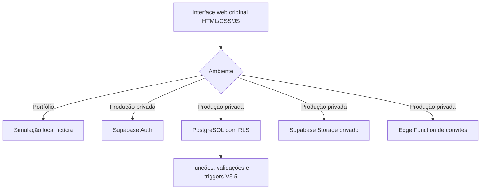

<div align="center">
  

  # Quermesse São Judas
  ### Gestão de quermesses, conferência financeira e autorização por perfis

  **Frontend original preservado · Backend V5.5 · JavaScript + Vite + Supabase + PostgreSQL**

  
  
  
  

  **Projeto de Engenharia de Software concebido para uma necessidade operacional real:** organizar a gestão de barracas, fechamentos e relatórios de uma quermesse, com respeito aos diferentes níveis de permissão.

  [Funcionalidades](#-funcionalidades) · [Executar](#-como-executar) · [Arquitetura](#-arquitetura) · [Segurança](#-segurança-e-privacidade) · [Limitações](#-status-e-limitações)
</div>

---

## 🎯 Problema e solução

Em uma quermesse, diferentes barracas arrecadam valores e entregam comprovantes à coordenação. Quando esses registros estão espalhados em mensagens, fotografias e planilhas, conferir os fechamentos, identificar pendências e comparar edições torna-se trabalhoso.

O **Quermesse São Judas** reúne esse processo em uma aplicação web: cada colaborador pode enviar seu próprio fechamento; administradores analisam os documentos, aprovam ou solicitam correções; e informações financeiras só são compartilhadas mediante autorização. O projeto foi pensado para apoiar a comunidade São Judas Tadeu, em São Paulo, e pode ser adaptado para outras iniciativas comunitárias.

> **Dois ambientes, responsabilidades diferentes:** o repositório público demonstra a arquitetura e oferece **dados exclusivamente fictícios**. A produção da igreja deve usar outro projeto Supabase, credenciais próprias, backup, HTTPS e testes de permissões.

## ✨ Funcionalidades

| Módulo | Administrador | Colaborador |
|---|---|---|
| Autenticação individual | Faz login com Supabase Auth | Faz login com Supabase Auth |
| Barracas | Cadastra, renomeia, ativa e desativa | Visualiza barracas ativas atribuídas |
| Edições da quermesse | Cria eventos com datas de início e fim | Escolhe evento ativo ao enviar |
| Fechamentos | Consulta valores, comprovantes e situações | Envia foto, data, valor e observação |
| Conferência V5.5 | Aprova ou solicita correção com justificativa | Reenvia registro corrigido, vinculado ao original |
| Acesso a dados financeiros | Consulta indicadores e detalhamentos | Não consulta valores históricos dos próprios fechamentos |
| Filtros | Filtra por evento, barraca, status e texto | — |
| Comparativos | Compara arrecadação de edições e de barracas | — |
| Equipe | Convida, atribui barraca, ativa e desativa usuários | — |
| Relatórios | Concede e revoga visualização de resumos financeiros | Consulta somente os resumos liberados |
| Auditoria | Visualiza eventos administrativos registrados | — |
| Exportação CSV | Exporta IDs, datas, valores e status de fechamentos aprovados | — |

Apenas **fechamentos aprovados** entram nos totais e comparativos. O compartilhamento é um **snapshot** (retrato de valores na data da liberação), e a revogação remove o acesso às consultas futuras.

## 🖥️ Demonstração sem dados reais

O modo demo vem ativado por padrão (`VITE_DEMO_MODE=true`). Depois de iniciar o projeto, a tela original de login apresenta botões **Explorar como administrador** e **Explorar como colaborador**. Isso é uma simulação local; não autentica nem consulta informações reais da igreja.

A demo inclui três edições fictícias de quermesse, oito barracas e fechamentos de exemplo. Os dados simulados podem ser alterados no navegador e ficam no `localStorage`; não são registros contábeis e o modo demo **não aplica autenticação ou RLS real**.

## 🧱 Arquitetura



### Estrutura de pastas

```text
quermesse-sao-judas/
├── index.html                   # Estrutura HTML e layout originais
├── public/assets/              # Ilustração original usada no frontend
├── src/
│   ├── main.js                  # Inicialização, sessão, estado e navegação
│   ├── state.js                 # Estado central do frontend
│   ├── styles.css               # CSS original preservado
│   ├── lib/
│   │   ├── analytics.js         # Comparativos, totais, filtros, CSV
│   │   └── format.js            # Escape HTML, moedas, datas, validações
│   ├── services/
│   │   ├── client.js            # Cliente Supabase ou demo (separados)
│   │   └── demoClient.js        # Simulador local com dados fictícios
│   └── ui/
│       ├── admin.js             # Telas administrativas
│       ├── collaborator.js      # Telas do colaborador
│       └── bindings.js          # Eventos e ações dos formulários
├── supabase/
│   ├── migrations/              # SQL V5.5 para banco NOVO
│   └── functions/               # Convites autenticados por Edge Function
├── tests/                       # Testes unitários e de contrato
├── docs/                        # Arquitetura, segurança, implantação, testes
├── scripts/                     # Verificação de segredos
├── .github/workflows/ci.yml     # Verificação automática no GitHub
├── .env.example                 # Modelo sem segredos
├── .gitignore                   # Impede env real, builds e arquivos privados
└── package.json
```

## 🔐 Segurança e privacidade

O projeto trabalha com uma regra simples: **ocultar um botão não é controle de acesso**.

Na arquitetura real, políticas RLS no PostgreSQL e permissões por coluna restringem operações. O colaborador pode inserir fechamento para sua barraca, mas não recebe `SELECT` dos valores em `closings`. Para acompanhar correções, existe `closing_feedback`, uma tabela sem `amount`/`receipt_path`. A liberação individual expõe somente um resumo em `report_shares`. A Storage privada restringe leitura de comprovantes à administração.

Reforça: (1) vínculos de reenvio por usuário, barraca, evento e data; (2) proibição de duas substituições do mesmo fechamento; (3) revisão apenas de `pending` para `approved`/`correction`; (4) imutabilidade de valor e comprovante durante a revisão.

| Publicável no GitHub | **Não** publicável |
|---|---|
| Código do frontend revisado | `.env` real e senhas |
| SQL de schema/policies sem dados privados | Dumps do banco e registros financeiros |
| Edge Function sem segredos | `service_role`, chaves secretas, tokens |
| Exemplos fictícios e documentação | Comprovantes, e-mails e contas reais |

**Pendências antes da produção:** testes de permissão com usuários reais em ambiente de homologação, backups e restauração, configuração de SMTP, proteção de senhas vazadas no Supabase Auth, domínio HTTPS, revisão de LGPD/retenção, monitoramento e proteção contra envio de fotos órfãs. A equipe precisa revisar o comportamento de `SECURITY DEFINER` e da Edge Function antes de depender financeiramente do sistema.

Veja o checklist em [docs/SECURITY.md](docs/SECURITY.md).

## 🧪 Status e limitações

- **Frontend:** telas e lógica originais reorganizadas em módulos, com recursos de filtros e comparativos adicionais.
- **Backend:** instalação limpa baseada nas regras V5.5, separada do banco da instituição.
- **Testes automatizados:** regras de analytics, validações, mock de autorização e contratos de segurança.
- **Ponta a ponta com Supabase:** **não certificado** neste repositório; deve ser feito antes de operar dados reais.
- **Build Vite:** depende de instalar pacotes npm. Se a instalação não for possível em um ambiente offline, teste no computador com acesso ao registro npm.
- **Demo:** apenas simulação; ela não deve ser usada como sistema financeiro ou autenticação de verdade.

Consulte [docs/TEST_PLAN.md](docs/TEST_PLAN.md) para o roteiro de testes.

## 🗺️ Próximas melhorias

- Testes E2E automatizados no navegador e com uma instância temporária do Supabase;
- Melhor tratamento de erro e limpeza de comprovantes órfãos;
- Relatórios com gráficos e exportações adicionais;
- Indicadores de evolução ao longo dos dias de cada quermesse;
- Rotina de backups, monitoramento e guia de suporte à equipe da igreja;
- Acessibilidade e documentação do projeto para manutenção de longo prazo.

**Projeto de portfólio independente.** A associação ao contexto da quermesse é descritiva e não representa certificação, publicação oficial ou garantia de aprovação para uso contábil pela instituição. Todos os dados do repositório são fictícios.
