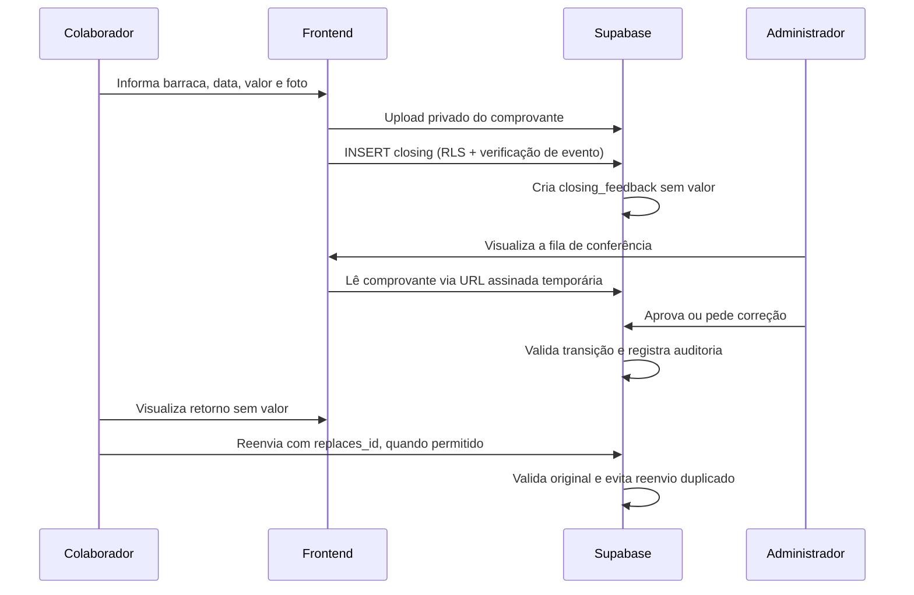

# Arquitetura

## Domínio
- **Usuário:** perfil em `profiles` vinculado ao `auth.users` do Supabase. Papel `admin` ou `collaborator`, com flag `active`.
- **Barraca:** `stalls`, que pode ser desativada sem apagar dados históricos. `profile_stalls` relaciona colaboradores às suas barracas.
- **Edição:** `events`, com datas de início e fim; um fechamento pertence a uma edição.
- **Fechamento:** `closings`, com valor, foto, data, observações e status.
- **Retorno:** `closing_feedback`, registro sem valor e comprovante para acompanhamento pelo colaborador.
- **Compartilhamento:** `report_shares`, snapshot financeiro individual revogável.
- **Auditoria:** `audit_log`, alimentado por triggers para atualizações de fechamento e compartilhamento.

## Fluxo de fechamento

## Fronteiras de confiança
A tela de login e os botões não concedem permissões. A versão conectada usa JWT emitido pelo Auth, RLS em todas as tabelas públicas, privilégios SQL por coluna, políticas de Storage e uma Edge Function com validação da identidade e do perfil admin. A demo simula os fluxos para portfólio, mas **não implementa isolamento de segurança real**.

## Não foi feito
A integração com Power BI, os testes E2E contra o banco real e a infraestrutura completa de observabilidade não estão incluídos neste pacote. Não apresentar esses itens como prontos em entrevistas.
